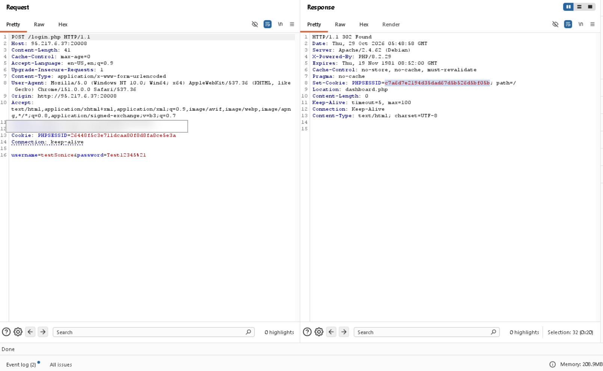
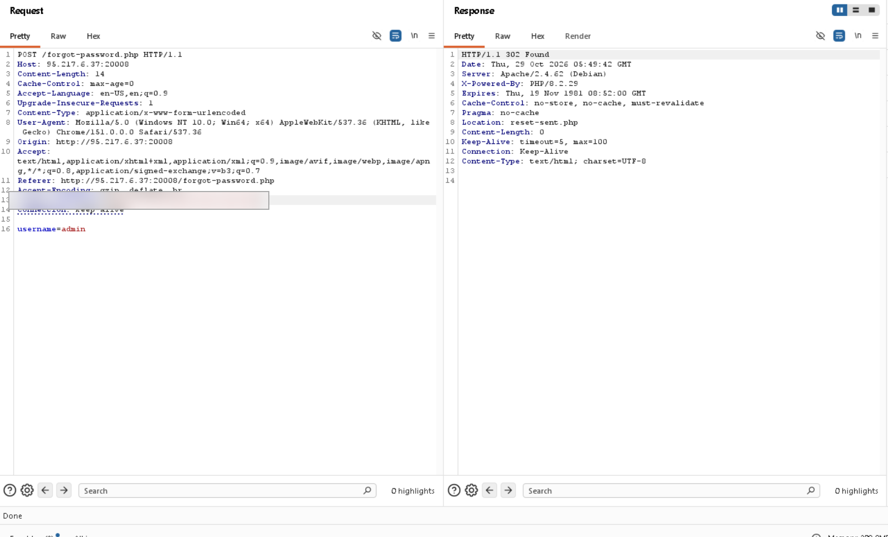
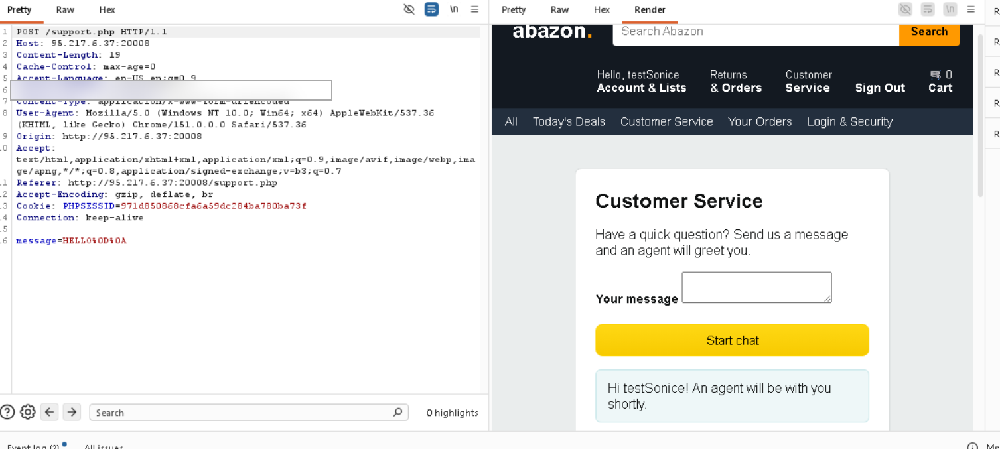
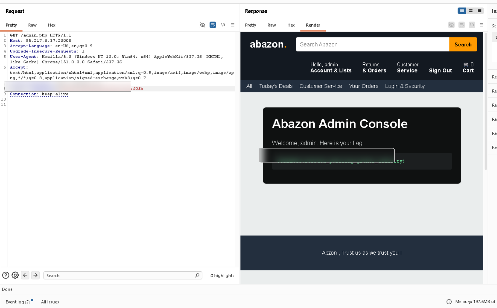

# Abazon — FahemSec Web CTF Write-up
**Author:** `S0n1c_404`  
**Category:** Web Exploitation · **Difficulty:** Easy · **Points:** 100  
**Finding:** Session Puzzling / Session Variable Overwrite

> **Publication-safe edition:** This version intentionally omits the final copy-paste exploit sequence and obscures the flag in the screenshot. It documents the investigation and evidence without serving as a turnkey exploitation recipe.

## 1. Challenge overview

The Abazon challenge is a PHP e-commerce-themed web application. Its description points to `admin.php` and says that brute forcing and fuzzing are unnecessary. I took this as a hint to focus on application logic and the way the site maintains state between requests.

**Scope:** The intended FahemSec challenge instance only.

## 2. Reconnaissance — mapping the application

I started by opening the home page and reviewing the navigation and the main user journeys. I identified the following features and routes during manual browsing:

| Feature | Endpoint | What I checked |
|---|---|---|
| Home page | `index.php` | Navigation and visible functionality |
| Registration | `register.php` | Account creation flow |
| Login | `login.php` | Authentication and session cookie |
| Password recovery | `forgot-password.php` | Submitted username, redirects, session behavior |
| Reset workflow | `reset.php`, `reset-sent.php` | Recovery flow transitions |
| Customer support | `support.php` | Session-aware page behavior |
| User dashboard | `dashboard.php` | Behavior after login |
| Profile | `profile.php` | Account-management functionality |
| Admin console | `admin.php` | Access-control behavior |
| Cart / logout | `cart.php`, `logout.php` | Supporting application features |

The goal at this stage was not to run a large scan. It was to understand which pages were public, which required a session, and which workflows could influence the same session.

## 3. Baseline: normal login

I created a normal test account and logged in through the intended flow. In Burp Suite, I captured the login request and the server response.

The response redirected the browser to the dashboard and set a `PHPSESSID` cookie. This established a baseline for how the application maintained state for an authenticated user.



*Figure 1 — Login flow captured in Burp Suite. For public sharing, session identifiers should be treated as sensitive and redacted if they may still be valid.*

### What I recorded

- HTTP method and endpoint.
- Status code and redirect destination.
- Whether a `Set-Cookie` header appeared.
- Whether later requests carried the same session cookie.
- The content returned after the redirect.

A session cookie identifies a server-side session; it does not by itself prove that a user has administrative permissions.

## 4. Investigating password recovery

Next, I reviewed the password-recovery feature. The captured request submitted a username, and the server returned a redirect to the reset workflow.



*Figure 2 — Password-recovery request and redirect response. The intermediate response is important: following redirects automatically can make it harder to understand the order of session-state changes.*

The redirect alone was not the vulnerability. The important clue was the way session state behaved around this workflow and how that state appeared to interact with other session-aware features.

## 5. Hypothesis: shared session state

At this point, I considered whether the application reused a session variable for more than one purpose. A password-recovery workflow needs to remember which account is being recovered, but that value must not become proof that the requester is authenticated as that account.

A simplified **illustrative anti-pattern** would be:

```php
// Illustrative example only — not confirmed challenge source code.
$_SESSION['username'] = $requestedUsername;
```

If an authentication or authorization check later trusts that same variable as the logged-in identity, separate workflows have become coupled in an unsafe way.

This class of issue is commonly described as **Session Puzzling** or session-variable overloading.

## 6. Correlating application behavior

I compared the requests and responses from login, password recovery, customer support, and the administrative route. I paid particular attention to:

- `Cookie` and `Set-Cookie` headers.
- Redirect destinations and status codes.
- The order in which requests were sent.
- Whether the rendered page reflected the expected user context.
- Whether the administrative route enforced authorization consistently.



*Figure 3 — Customer-support page captured during session-behavior investigation. This is contextual evidence of session-aware behavior, not proof of the root cause by itself.*

The key lesson was that an individual endpoint may look normal when tested alone, while a particular sequence of otherwise ordinary requests can expose a state-management flaw.

## 7. Impact verification

The administrative page displayed the challenge flag when accessed with the resulting session state. The public copy of this write-up intentionally obscures the flag and omits the final copy-paste request sequence.



*Figure 4 — Administrative console. The flag area is intentionally blurred for the public edition.*

**Result:** The challenge was solved. The exact flag and final exploit sequence are withheld from this public copy.

## 8. Root cause analysis

The observed behavior is consistent with a session-state trust-boundary failure: a value associated with password recovery can influence security-sensitive behavior elsewhere in the application.

The concepts that must remain separate are:

1. **Recovery target:** the account involved in a recovery request.
2. **Authenticated identity:** the account whose identity has been verified.
3. **Authorization:** the actions permitted to that authenticated identity.

A username supplied by a requester is not proof of account ownership. Starting password recovery must not authenticate the requester or grant administrative privileges.

The screenshots demonstrate the request flow and final administrative access. They do not reveal the exact PHP source code, so the specific internal implementation should be treated as a hypothesis unless confirmed by source review.

## 9. Remediation

### Separate workflow state

Use dedicated state for password recovery rather than reusing an authentication identity variable. Distinct variable names help, but the application must also enforce the correct trust boundaries.

### Enforce authorization server-side

Every administrative endpoint should verify the authenticated identity and permissions on the server. Hiding an admin link in the UI is not access control.

### Use secure recovery tokens

Recovery tokens should be unpredictable, expire, be single-use, and be bound to the intended account. A recovery request must not create an authenticated session for that account.

### Regenerate session identifiers appropriately

PHP applications should consider regenerating session IDs after successful authentication and privilege changes. This helps mitigate session fixation, but does not fix broken authorization or session-variable reuse on its own.

### Add regression tests

Test that a normal user cannot access admin routes, that requesting recovery for another account does not change the logged-in identity, and that each protected endpoint checks authorization independently.

## 10. Lessons learned

- Map the application's real features before testing individual parameters.
- Track session cookies and redirects as part of the evidence.
- Test workflows in sequence, not only one endpoint at a time.
- Separate authentication, recovery, and authorization state.
- Distinguish confirmed observations from assumptions about the source code.
- Redact session cookies and sensitive challenge output before publishing screenshots.

## 11. Conclusion

Abazon demonstrates how a session-management flaw can undermine access control when different application workflows share security-sensitive state. The investigation began with manual feature mapping, established a normal login baseline, examined password recovery, compared session-aware pages, and verified the impact at the administrative endpoint.

**Author:** `S0n1c_404`  
**Challenge:** Abazon — FahemSec  
**Finding:** Session Puzzling / Session Variable Overwrite

## References

- [FahemSec — Challenges](https://fahemsec.com/challenges)
- [OWASP Session Management Cheat Sheet](https://cheatsheetseries.owasp.org/cheatsheets/Session_Management_Cheat_Sheet.html)
- [OWASP Authorization Cheat Sheet](https://cheatsheetseries.owasp.org/cheatsheets/Authorization_Cheat_Sheet.html)
- [PHP Manual — Sessions](https://www.php.net/manual/en/book.session.php)
